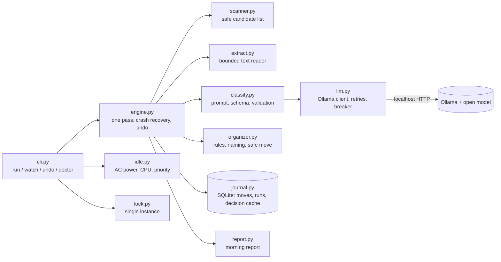

# Architecture

## Separation of concerns
- `config.py` validates everything up front and fails fast; nothing else reads environment variables.
- `scanner.py` decides *what* is eligible; `organizer.py` decides *where* it goes and moves it safely;
  `classify.py` decides *what it is*; `engine.py` only orchestrates.
- `llm.py` hides the provider behind a small `LLMClient` protocol. A second provider (an OpenAI-compatible
  endpoint) exists only so the evaluation harness can measure a closed-model baseline; the app defaults to Ollama.

## Data flow for one file
1. Scanner skips anything risky (hidden, symlink, partial, too new, too large).
2. Known extension: route by rule. Otherwise extract up to `text_chars` characters.
3. Hash the file; if (hash, model, prompt version) was seen, reuse the decision.
4. Otherwise ask the model for JSON constrained by a schema with a category enum.
5. Validate the reply against the allow-list; clamp and check confidence.
6. Below threshold: leave in place, record why. Else compute a non-clobbering destination inside `Sorted/`.
7. In apply mode: journal a `pending` row, move, mark `moved`. A crash between those steps is settled at the next start.

## Data model (SQLite, WAL mode, versioned migrations via `PRAGMA user_version`)
- `runs`: id, mode, status, timestamps, summary JSON.
- `moves`: run id, source, destination, status (`pending/moved/failed/undone/skipped`), hash, category, confidence, model, prompt version.
- `decisions`: cache keyed by (sha256, model, prompt version).
All queries use bound parameters. History can be pruned with `purge` and copied with `backup`.

## Key decisions
- **Standard library only** at runtime (optional `pypdf`, `psutil`): fewer dependencies to audit, easier install.
- **Rules before model**: extension routing is free; the model is the expensive path on weak hardware.
- **Leave it alone when unsure**: a missed file costs seconds, a wrong move costs trust.
- **Journal first, move second**: makes undo and crash recovery possible.
